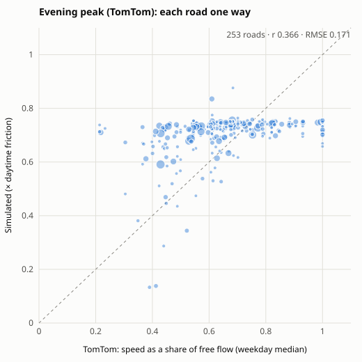

# The morning's and the evening's traffic from TomTom, and the centre's one-way streets (ticket #321)

The plan: **Bistrița Auto Search** (`b87c01a7-…`, revision 101). Everything here is reproducible with
`scripts/tomtom-321.ts` (stages `fetch`, `free`, `calibrate`, `optimize`, `final`, `patch`, `figures`) and checked by
`npm run tomtom-321:check`. The TomTom data is the collector's, exported with
`npm run traffic:export -- b87c01a7-40ea-4aa3-a72a-7c917a58091b --from 2026-11-16 --to 2026-11-24` (5 MB, not kept
here: pass it as `--export <file>`). plan.json is the plan as it was used (the main plan only).

## 1. What TomTom recorded

Since 16 November the collector (docs/traffic-history.md) has saved TomTom's flow every 5 minutes, 06:00–09:00 and
16:00–19:00 local time (UTC+2). That is 575 snapshots up to 24 November, over 692 one-way roads ("ways").
TomTom gives **speeds, not vehicle counts**. For each way it gives the speed driven as a share of its free-flow
speed, which is the night's.

Over the whole network, weekdays only:

- **Morning:** the town slows from about 07:10 and is slowest at 07:55, at 55% of free flow. It is back to about
  83% by 08:35. The worst hour is **07:30–08:30**.
- **Evening:** the town is slowest at 16:00–16:30, at 58–64%, and eases to 89% by 19:00. The worst recorded hour is
  **16:00–17:00**. The collector starts at 16:00, so the peak may begin earlier.
- **Weekends:** close to free flow.

For each way and peak hour, the figure used is the median over the weekdays of each day's mean share. Only ways
TomTom covers at least half of, on at least 3 weekdays, count: **303 ways**, 253 of them 20 m or longer. Days agree
closely, with a typical spread of ±0.06. The slowest are Str. Ioan Slavici and Str. Crinilor (about 0.2 of free flow
in both peaks), Bd. Republicii south-west-bound, and Calea Moldovei.

## 2. From speeds to traffic: how it was inferred

The simulator was used as the model that turns traffic into speeds, and the traffic was adjusted until the slowdowns
matched TomTom's.

1. **Free flow in the simulator.** The plan is run headless in the app's own V2 simulation with almost no traffic
   (6 seeds × 40 min). Each way's mean speed, as distance over time spent on its lanes, is its free-flow speed.
   485 ways are driven, 269 of the 303 TomTom ones.
2. **A demand to adjust: a gravity model.** Each of the plan's 70 ways in sends **P** vehicles an hour, and each
   of its 68 ways out draws a share **A**. A trip from i to j is P·A_j/ΣA, never back out by the road it came in
   on. That is 138 numbers per peak, instead of 4,700 matrix cells that a few hundred speeds could never pin down.
   The start is 60 vehicles an hour per lane of each way in, with each way out weighted by its lanes.
3. **Simulate, compare, adjust, repeat.** Each round, the peak's demand is run on 4 seeds (10 min to fill the
   town, 20 min measured). Every car's way in, way out and the ways it drove are recorded. For each TomTom way, the
   error is the simulated share of free flow minus TomTom's. Each way in's P (and each way out's A) is then moved
   by the mean error over the ways its cars drove, weighted by how many cars and by the way's length × TomTom's
   cover. A way too fast in the simulator gets more traffic from the places that feed it; a way too slow gets less.
   This ran for 14 rounds, and the best round is kept.
4. **Daytime friction.** The first attempt showed that the simulator can't make the town as slow as TomTom says
   with traffic alone. Before it does, it starts to gridlock (33 deadlocks a run at 6,600 veh/h, still 0.21 too
   fast on average). TomTom's free flow is the night's, and by day parking, people crossing, buses and bikes slow
   town streets whatever the traffic; the simulator models none of that. So one network-wide factor φ scales the
   simulated shares. It is the least-squares fit, kept between 0.75 and 1, and the demand has to explain the rest.
   It settled at the bottom of its range, **φ = 0.75**: a quarter of TomTom's peak slowdown is put down to friction,
   not traffic. In the same spirit, a round where the simulator gridlocks (more than 3 deadlocks or 40 cars stood
   still per run, on average) takes 15% off every way in, since Bistrița doesn't gridlock every day. The demand
   settles where the simulator stops coping, about **5,300 vehicles an hour coming in**.
5. **Is it real, or just fitted? Held-out roads.** The roads were split in two by id. The calibration was run on
   one half only, then scored on the other half, which it never saw:

   | peak | held-out roads: RMSE of the share | correlation | at the start (demand by lanes) |
   |---|---|---|---|
   | morning | **0.193** | **0.32** | 0.202, 0.25 |
   | evening | **0.177** | **0.29** | 0.187, 0.23 |

   On roads it never saw, the inferred demand predicts congestion better than the lane-count guess it started
   from. So it learnt something true about where Bistrița's peak traffic goes. But the improvement is modest, and
   the correlation stays around 0.3: most of the way-by-way pattern in TomTom's speeds is **not** explained by this
   demand on this plan. The likely reasons are friction that differs street by street (a school, a car park, a
   market), signals not drawn in the plan, and TomTom's matching of short streets.
6. **The demand delivered** is the calibration on all the ways:

   | | morning (07:30–08:30) | evening (16:00–17:00) |
   |---|---|---|
   | vehicles an hour coming in | 5,382 | 5,261 |
   | fit on all 253 ways: RMSE, correlation | 0.179, 0.42 | 0.171, 0.38 |
   | trips from the town's edge / to it | 40% / 33% | 38% / 40% |
   | trips starting in the centre | 10.5% | 13.6% |

   The morning comes into town and the evening leaves it, as commuting would. The busiest destination in both is
   Str. Mihai Eminescu.

    

   Re-run on 4 seeds it never ran (`figures`), the fit holds: morning RMSE 0.179, r 0.41; evening 0.171, r 0.37.
   The plots show the limit plainly. The simulator slows many of the roads TomTom shows jammed: Calea Moldovei, Bd. Decebal,
   Str. Năsăudului and Str. Cuza Vodă in the morning; in the evening Bd. Republicii and Str. Gării, which it slows
   more than TomTom does (0.13 against 0.39). But most roads sit near φ: it barely slows them, while TomTom shows
   them anywhere from 0.3 to 1.

## 3. The centre's streets: one-way, two-way, turned round

**The centre** is inside Bd. Republicii, Bd. Gen. Grigore Bălan and Str. Ecaterina Teodoroiu, Str. Parcului and
Str. Dogarilor, and Str. Alexandru Odobescu: Piața Centrală, Piața Mică, Piața Unirii, Str. Dornei, Str. Nicolae
Titulescu and so on (`src/lib/experiments/tomtom-321/centre.ts`). It has no traffic lights.

**The changes, as read from the ticket:**

- a two-lane two-way street (one lane each way) made one-way on both lanes, either way;
- a two-lane one-way street made one lane each way;
- a one-lane one-way street turned round.

A change applies to a whole **street**: its road pieces of the same name, joined end to end and set out the same
way. Turning round only half of a one-way street would point the halves at each other. The candidates are the
centre's named streets, not the boulevards around it or unnamed pieces of junctions: **25 streets, 35 changes**.

**Making a change on the V2 plan** (`directions.ts`). The editor's "reverse lane" leaves a lane's connectors where
they were, so the turns at both ends are made again, as one would draw them:

- every way in goes to every way out of another road, with no U-turns;
- straight on goes lane to lane;
- a left turn goes from the leftmost lane to the leftmost lane;
- a right turn goes from the rightmost lane to the rightmost lane.

A turned lane's give-way or stop sign follows its street (none here had one). A change is **refused** when it would
cut any trip off (some way in no longer reaching a way out it reaches today), or when it would leave a lane nobody
can drive onto or off. Making Piața Centrală two-way is one example: it would run a lane back into a junction that
every other road only leaves. **13 changes are sound**; `npm run tomtom-321:check` checks each one.

**The search** (`optimize`) is greedy. Each round tries every sound change on top of those already kept, in both
peaks, on 2 seeds each, with today's layout run on the same seeds. The score is half the centre's delay
(vehicle-hours an hour on its roads) and half the time per trip asked for across the whole town. A trip the town
can't take counts as 10 minutes, so moving traffic out of the centre can't win by stranding it. Both halves are
measured against today, and the score is the mean over peaks and seeds: 1 is today, lower is better. A change is
kept only if it beats the current design by more than 0.01, about the runs' noise.

| round | kept | score | runner-up |
|---|---|---|---|
| 1 | Str. Ecaterina Teodoroiu one-way (southbound) | 0.934 | Str. Liviu Rebreanu turned round, 0.935 |
| 2 | + Str. Liviu Rebreanu turned round (south-west-bound) | 0.921 | + Str. M. Kogălniceanu one-way, 0.927 |
| 3 | nothing better by 0.01 (best + Piața Unirii two-way, 0.917) | | |

Making the two-lane one-way streets two-way never helped: Piața Unirii scored 1.002 and Str. Barbu Ș.
Delavrancea 1.051.

**Checked on 6 fresh seeds per peak** (`final`):

| | today | Ecaterina Teodoroiu one-way | + Liviu Rebreanu turned round |
|---|---|---|---|
| score | 1 | 0.955 | **0.933** |
| morning: centre delay, vehicle-hours an hour | 8.17 | 7.03 | **6.69 (−16%)** |
| evening: centre delay | 7.26 | 6.48 | **6.34 (−13%)** |
| morning / evening: time per trip | 235 / 255 s | 241 / 260 s | 237 / 258 s |
| morning / evening: trips an hour | 4,850 / 4,484 | 4,806 / 4,470 | 4,812 / 4,504 |
| centre vehicle-km, morning / evening | 626 / 760 | 604 / 699 | 602 / 692 |

The evening gain shows on every seed (−10% to −16%). The morning is noisier: 0% to −35% by seed, −14% leaving
out one run where Bd. Republicii × Str. Gării gridlocked. That junction is outside the centre and unchanged, and it
is a weak spot today too. On three clean seeds the design sends no more traffic through it (705, 696, 616 cars
against 746, 690, 641) and its delay per car is lower. Collisions are unchanged. Deadlocks broken up in the morning
rise from 1.3 to 8.5 a run, mostly that one stall.

**What the two changes do.** Together they make a one-way loop on the centre's east side. Rebreanu brings
traffic in from the ring (Bd. Gen. Grigore Bălan, Str. C. Roman Vivu), and Ecaterina Teodoroiu takes it south to
Zorilor and Barbu Lăutaru on both lanes. That corner is then reached and left without crossing Piața Unirii, and
the centre carries 4–9% fewer vehicle-km. The cost is a couple of seconds a trip for some longer ways round.

## 4. Delivered

**Agent patch #7** on the plan, for you to apply or reject:

- the two matrices, "Morning peak (TomTom)" (07:00–09:30) and "Evening peak (TomTom)" (15:30–18:30);
- lanes l388 (Ecaterina Teodoroiu) and l2858 (Liviu Rebreanu) turned round;
- 10 connectors out and 6 in (c321-1 … c321-6).

The patch doesn't switch the demand in use: pick a matrix in Demand, or "By the time of day" with the clock at
07:30 or 16:00. For this, agent patches can now carry demand matrices (`matrices` items; patch:check).

## Limits

- TomTom gives speeds. Turning speeds into traffic needs a model, and this one is the simulator plus a gravity
  demand. A different demand that slows the same roads would fit as well. The held-out test shows this one is
  better than a guess, but only modestly so.
- The friction factor sits at its floor of 0.75, and the demand is capped where the simulator starts gridlocking.
  So the absolute numbers (5,300 vehicles an hour) are the simulator's, not a count. Real counts on a few roads
  would pin them down.
- The evening peak may start before 16:00, when the collector begins.
- The search changes one street at a time. Combined changes that only work together (a whole loop of one-way
  streets turned round) were not tried; most single reversals in the centre are refused because they cut a pocket
  of streets off.
